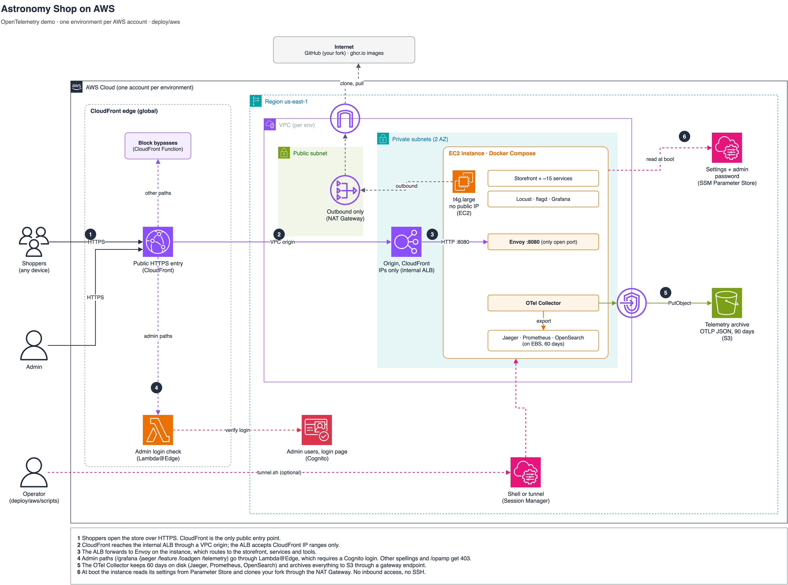

# Deploying the Astronomy Shop to AWS

This folder deploys the OpenTelemetry demo (the Astronomy Shop, its core services and the
observability stack) to AWS. Each environment (`dev`, `demo`, ...) lives in its own AWS
account. One script creates everything with CloudFormation. You get:

- a public HTTPS storefront that anyone can open from any device;
- the admin tools (Grafana, Jaeger, flagd, Locust, telemetry docs) at the same address,
  behind a username and password login;
- 60 days of traces, metrics and logs on the instance, plus a 90-day raw archive in S3;
- a built-in load generator that simulates 5 shoppers around the clock.

**Contents**

1. [Architecture](#1-architecture)
2. [What is in this folder](#2-what-is-in-this-folder)
3. [Before you start](#3-before-you-start)
4. [Deploy an environment, step by step](#4-deploy-an-environment-step-by-step)
5. [Admin login and users](#5-admin-login-and-users)
6. [Using the environment](#6-using-the-environment)
7. [Changing an environment](#7-changing-an-environment)
8. [Deleting an environment](#8-deleting-an-environment)
9. [Costs](#9-costs)
10. [Security notes](#10-security-notes)
11. [Troubleshooting](#11-troubleshooting)
12. [Limitations](#12-limitations)

## 1. Architecture



The numbered steps in the diagram:

1. Shoppers open the store over HTTPS. CloudFront is the only public entry point.
2. CloudFront reaches an **internal** Application Load Balancer through a VPC origin. The
   load balancer accepts traffic from CloudFront's IP ranges only.
3. The load balancer forwards to Envoy on the EC2 instance (port 8080, the only port that
   is open). Envoy routes to the storefront, the services and the tools.
4. Admin paths (`/grafana`, `/jaeger`, `/feature`, `/loadgen`, `/telemetry`) go through a
   Lambda@Edge function that requires a Cognito login. `/opamp` and other spellings of the
   admin paths (for example `//Grafana`) get 403 from a CloudFront Function.
5. The OpenTelemetry Collector keeps 60 days of data on the instance's disk (Jaeger,
   Prometheus, OpenSearch) and also archives everything to S3 through a VPC gateway endpoint.
6. At first boot the instance reads its settings from SSM Parameter Store and downloads
   this repository from GitHub through the NAT Gateway. It has no public IP and no SSH.

**Editing the diagram:** the editable source is
[`docs/architecture.drawio`](docs/architecture.drawio), with AWS icons. Open it in
[draw.io Desktop](https://www.drawio.com/), at [app.diagrams.net](https://app.diagrams.net),
or in VS Code / Kiro with the *Draw.io Integration* extension (`hediet.vscode-drawio`).
After editing, export it over `docs/architecture.png` (**File > Export as > PNG**).
To regenerate the file from code instead, edit and run
`python3 deploy/aws/docs/generate_diagram.py`. That script also writes the PNG, using the
draw.io CLI if it is installed or a simplified SVG preview otherwise.

## 2. What is in this folder

```text
deploy/aws/
  README.md                     this guide
  docs/architecture.drawio      editable architecture diagram
  docs/architecture.png         the image above
  docs/generate_diagram.py      regenerates the diagram files
  envs/example.env              template for one environment's settings
  templates/network.yaml        VPC stack, named <env>-otel-network
  templates/otel-demo.yaml      application stack, named <env>-otel-demo
  config/compose.aws.yaml       Docker Compose overlay: closes ports, stores data on disk
  config/jaeger-badger.yml      Jaeger: disk storage instead of memory
  config/otelcol-config-aws.yml Collector: adds the S3 archive
  scripts/deploy.sh             create or update an environment
  scripts/verify.sh             check that an environment works (read-only)
  scripts/admin-password.sh     print the default admin's password
  scripts/users.sh              list, add, reset and remove admin users
  scripts/apply-config.sh       push config changes to the running instance
  scripts/tunnel.sh             optional: shell or port forward through Session Manager
  scripts/destroy.sh            delete an environment
  scripts/bootstrap.sh          runs on the instance at boot; never run it yourself
  scripts/lib.sh                shared helpers
```

Nothing outside `deploy/aws/` is modified. The AWS-specific settings are overlays loaded
after the upstream Compose and Collector files, so you can merge new upstream releases
without conflicts.

## 3. Before you start

### On your computer (macOS or Linux)

| Tool | Check with | Install |
|---|---|---|
| AWS CLI v2 | `aws --version` | <https://docs.aws.amazon.com/cli/latest/userguide/getting-started-install.html> |
| git | `git --version` | usually preinstalled |
| bash, curl, python3 | `python3 --version` | preinstalled on macOS and most Linux |

If `aws` is installed somewhere that isn't on your `PATH`, you can point the scripts at it
with `AWS_CLI=/usr/local/bin/aws` in the environment file (step 3).

The **Session Manager plugin** is *not* required. You sign in to the admin tools in the
browser. Install it only if you want a shell on the instance for troubleshooting
(see [Using the environment](#6-using-the-environment)).

### In each AWS account

- Credentials for a user or role that can create VPC, EC2, Elastic Load Balancing,
  CloudFront, Cognito, Lambda, IAM roles, S3 and SSM resources. In a dedicated demo
  account, the `AdministratorAccess` policy is the simplest choice.
- Region **us-east-1**. See [Limitations](#12-limitations).
- Room under two default quotas, unless you reuse an existing VPC: 5 VPCs and
  5 Elastic IP addresses per region. Check them in the console under
  **Service Quotas > Amazon VPC** and **Amazon EC2**.

### This repository

The EC2 instance can't see the copy of the repository on your computer. At first boot
it downloads the code from GitHub, using the same repository and branch you have
checked out. Two things follow:

- The repository on GitHub must be **public**, so the instance can download it without
  credentials.
- Your commits must be **pushed** before you deploy. `deploy.sh` checks this and stops if
  your local branch doesn't match GitHub.

## 4. Deploy an environment, step by step

Run every command in this section in a terminal on your computer, from the **root folder
of this repository** (the folder that contains `compose.yaml` and `deploy/`). The scripts
read the environment file path relative to that folder.

### Step 1. Open a terminal in the repository folder

```bash
cd ~/path/to/opentelemetry-demo     # replace with where you cloned the repository
git status
```

`git status` should show the branch you want to deploy (for example
`On branch aws-deploy`) and `Your branch is up to date with 'origin/aws-deploy'`. If it
says your branch is ahead, run `git push` first.

### Step 2. Sign in to the target AWS account

The scripts use an AWS CLI **profile**: a name that points at a set of credentials.
Pick the option that matches how you sign in to AWS.

**Option A: the default profile (access keys).** If you've only ever run
`aws configure`, your credentials are in the profile named `default`. To set it up:

```bash
aws configure
# AWS Access Key ID:     <your key>
# AWS Secret Access Key: <your secret>
# Default region name:   us-east-1
# Default output format: json
```

**Option B: a named profile with IAM Identity Center (SSO).** Set it up once, then sign
in whenever your session expires:

```bash
aws configure sso --profile otel-dev     # answer the prompts once
aws sso login --profile otel-dev         # opens a browser to sign in
```

Then confirm which account the profile points at. Use `default` or your profile name:

```bash
aws sts get-caller-identity --profile default
```

The output looks like this. Write down the `Account` value for the next step:

```json
{
    "UserId": "AIDA...",
    "Account": "111111111111",
    "Arn": "arn:aws:iam::111111111111:user/your-user"
}
```

### Step 3. Create the environment file

Each environment has one small settings file in `deploy/aws/envs/`. Copy the example and
open the copy in an editor:

```bash
cp deploy/aws/envs/example.env deploy/aws/envs/dev.env
open -e deploy/aws/envs/dev.env          # macOS TextEdit; or use any editor
```

Three settings are required:

| Setting | What to put | Example |
|---|---|---|
| `ENV_NAME` | A short name for the environment: lowercase letters, digits and `-`, 2–15 characters. All stack and resource names start with it. | `dev` |
| `AWS_PROFILE` | The profile from step 2. | `default` or `otel-dev` |
| `EXPECTED_ACCOUNT_ID` | The `Account` value from step 2. Every script stops if the profile points at a different account, so you can't deploy to the wrong one by accident. | `111111111111` |

Example using the **default** profile:

```bash
ENV_NAME=dev
AWS_PROFILE=default
EXPECTED_ACCOUNT_ID=111111111111
```

Example using a **named** profile, with the AWS CLI in a non-standard location:

```bash
ENV_NAME=demo
AWS_PROFILE=otel-demo
EXPECTED_ACCOUNT_ID=222222222222
AWS_CLI=/usr/local/bin/aws
```

Everything else in the file is optional and documented in the file itself (instance
size, retention, disk size, admin login name, reusing an existing VPC, ...).

You don't need to set the repository URL or branch. `deploy.sh` reads them from this
checkout: the URL of the `origin` remote and the branch you have checked out. An SSH
remote such as `git@github.com:you/repo.git` is converted to HTTPS for the instance.
Set `REPO_URL` and `REPO_REF` only to deploy something other than your current checkout.

The file contains no secrets, so you can commit it to keep a record of each environment.

### Step 4. Run the deployment

```bash
deploy/aws/scripts/deploy.sh deploy/aws/envs/dev.env
```

**When:** after steps 1–3, and again whenever you change the environment file or a
template (see [Changing an environment](#7-changing-an-environment)).

**How long:** about 20–30 minutes for a new environment, mostly while CloudFront
distributes the configuration worldwide. Updates usually take 1–10 minutes. Keep the
terminal open until the script finishes; if it's interrupted, run it again. It continues
from wherever the stacks are.

**What it does:**

1. Checks that the profile belongs to `EXPECTED_ACCOUNT_ID`.
2. Works out the repository URL and branch, and checks that GitHub has the same commit
   as your computer.
3. Creates the network stack `dev-otel-network` (skipped if you set `VPC_ID`).
4. Creates the application stack `dev-otel-demo`.
5. Runs a short second update that registers the new CloudFront address as the
   login callback (first deploy only).
6. On later runs, pushes changed settings to the running instance.

**What you see:** progress lines that start with `==>`, and the AWS CLI's own
`Waiting for stack create/update to complete` lines. A successful run ends like this:

```text
Deployed environment 'dev'.
  Store:        https://d1234abcd.cloudfront.net/
  Admin tools:  https://d1234abcd.cloudfront.net/grafana/  /jaeger/ui/  /feature/  /loadgen/  /telemetry/
  Admin login:  admin@example.com
  Password:     deploy/aws/scripts/admin-password.sh deploy/aws/envs/dev.env
  Instance:     i-0123456789abcdef0
  S3 archive:   s3://astronomy-shop-dev-111111111111/

The instance needs 5-10 more minutes to pull images and start.
```

Copy the **Store** URL. That is the address you share.

**If it stops with `ERROR:`**, the message says what to fix (wrong account, branch not
pushed, repository not public, ...). Fix it and run the same command again. If a stack
fails inside CloudFormation, the reason is in the AWS console under
**CloudFormation > Stacks > dev-otel-demo > Events**. See also
[Troubleshooting](#11-troubleshooting).

### Step 5. Wait for the instance, then verify

The script finishes before the instance is ready. The instance is still downloading about
25 container images and starting them. **Wait 5–10 minutes**, then run:

```bash
deploy/aws/scripts/verify.sh deploy/aws/envs/dev.env
```

It only reads and never changes anything, so you can run it as often as you like. Each
line is a check:

```text
PASS  storefront / (200)
PASS  product API /api/products (200)
PASS  admin /grafana/ requires login (login)
...
PASS  blocked /opamp/ (403)
PASS  SSM agent online (i-0123456789abcdef0) (Online)
PASS  s3://astronomy-shop-dev-111111111111/traces/ has objects this hour
...
All checks passed.
```

If the storefront checks fail with 502 or 503, the instance is still starting; wait a few
minutes and run it again. If only the S3 checks fail, the Collector hasn't flushed its
first batch yet (it flushes once a minute); run it again after 2–3 minutes. If failures
remain after 15 minutes, see [Troubleshooting](#11-troubleshooting).

You can also just open the **Store** URL in a browser. The Astronomy Shop should load.

### Step 6. Sign in to the admin tools

Get the default admin's password:

```bash
deploy/aws/scripts/admin-password.sh deploy/aws/envs/dev.env
```

It prints one line: the password. Then:

1. In a browser, open `https://<your-store-address>/grafana/` (or any admin tool from
   the table in [Using the environment](#6-using-the-environment)).
2. You're redirected to a Cognito sign-in page. Enter `admin@example.com` (or your
   `ADMIN_EMAIL`) and the password.
3. You land on the page you asked for. The login lasts 12 hours and covers all admin
   tools. To sign out, open `https://<your-store-address>/_auth/logout`.

To give other people access, create a user for each of them. See the next section.

## 5. Admin login and users

### How it works

- Each environment has its own **Amazon Cognito user pool**, named `<env>-otel-demo-admin`.
  It contains the people who may use the admin tools. Nobody can sign up on their own.
- When someone opens an admin path, a Lambda@Edge function checks for a valid login
  cookie. Without one, it sends the browser to the Cognito sign-in page. After sign-in,
  Cognito sends the browser back with a token, the function checks the token's signature,
  and the browser receives a 12-hour cookie.
- The storefront itself never asks for a login.

### The default admin

The stack creates one user automatically:

| | |
|---|---|
| Login name | `admin@example.com`, or the value of `ADMIN_EMAIL` in the environment file |
| Password | 24 random characters, generated inside AWS during deployment |
| Where the password is stored | SSM Parameter Store, `/<env>/otel-demo/admin-password` (encrypted) |

The login name only has to *look like* an email address. Cognito never sends mail to it,
so a made-up address is fine, and the password never appears in templates, logs or
deployment output.

**Get the password** with the script (step 6 above), or in the AWS console:
**Systems Manager > Parameter Store > `/dev/otel-demo/admin-password` > Show decrypted value**.

**Change the default admin's login name:** set `ADMIN_EMAIL` in the environment file and
run `deploy.sh` again. The old user is replaced with the new one, and a new password is
generated and stored in the same parameter.

### Add, reset, list and remove users

Use `scripts/users.sh`, from the repository root, with the environment file as the
first argument.

**List users:**

```bash
deploy/aws/scripts/users.sh deploy/aws/envs/dev.env list
```

**Add a user.** The script creates the user, sets a random password and prints it once.
Send it to the person over a secure channel; it isn't stored anywhere else.

```bash
deploy/aws/scripts/users.sh deploy/aws/envs/dev.env add jane@example.com
```

```text
==> Created jane@example.com. Share the password over a secure channel; it is not stored anywhere.

  Login:    jane@example.com
  Password: Xk3m...
  Sign in:  https://d1234abcd.cloudfront.net/grafana/
```

**Reset a forgotten password.** For the default admin, the stored parameter is updated
too, so `admin-password.sh` keeps working:

```bash
deploy/aws/scripts/users.sh deploy/aws/envs/dev.env reset jane@example.com
```

**Remove a user.** The script asks you to type `yes`. The default admin can't be removed
this way, because CloudFormation manages it:

```bash
deploy/aws/scripts/users.sh deploy/aws/envs/dev.env remove jane@example.com
```

A browser that is already signed in keeps access until its 12-hour login expires.

**In the AWS console instead:** **Amazon Cognito > User pools > `dev-otel-demo-admin` >
Users > Create user**. Choose *Don't send an invitation*, enter the email address, tick
*Mark email address as verified*, and set a password (at least 16 characters with
uppercase, lowercase and digits). A password set in the console is temporary, so the
user is asked to choose a new one at first sign-in.

## 6. Using the environment

Replace `<store>` with your Store URL, for example `https://d1234abcd.cloudfront.net`.

| Address | Access | What it is |
|---|---|---|
| `<store>/` | Public | The Astronomy Shop storefront. Share it with anyone, on any device. |
| `<store>/grafana/` | Login | Dashboards. **Explore** queries Prometheus (metrics), OpenSearch (logs) and Jaeger (traces). |
| `<store>/jaeger/ui/` | Login | Individual traces, a per-service performance view (**Monitor**) and a service map. |
| `<store>/feature/` | Login | flagd: turn fault scenarios on and off (payment failures, slow services, memory leaks, ...). |
| `<store>/loadgen/` | Login | Locust: change the number of simulated shoppers. |
| `<store>/telemetry/` | Login | Reference of every span, metric and attribute the demo emits. |
| `<store>/_auth/logout` | Login | Sign out of the admin tools. |
| `/opamp/` | Tunnel only | OpAMP server. It can change the Collector's configuration, so it is never public. |

**Telemetry archive in S3.** Everything the Collector receives is also written to
`s3://astronomy-shop-<env>-<account>/` in three folders (`traces/`, `metrics/`, `logs/`),
split by time in UTC: `year=YYYY/month=MM/day=DD/hour=HH/minute=MM/`. Each file is a
gzipped batch in OTLP JSON format. Files older than 90 days are deleted automatically.

### Optional: shell and tunnel through Session Manager

Use this only for troubleshooting, or to reach `/opamp/`. It needs the Session Manager
plugin on your computer:

```bash
brew install --cask session-manager-plugin     # macOS; for Linux see the AWS docs
```

**Open a shell on the instance:**

```bash
deploy/aws/scripts/tunnel.sh deploy/aws/envs/dev.env shell
```

On the instance, run `sudo otel-demo-compose ps` to list the containers, or
`sudo otel-demo-compose logs -f otel-collector` to follow a container's log. The boot log
is `/var/log/otel-demo-setup.log`; its last line is `OTEL DEMO SETUP DONE` when setup
finished. Type `exit` to leave.

**Forward the instance's port 8080 to your computer:**

```bash
deploy/aws/scripts/tunnel.sh deploy/aws/envs/dev.env
```

Leave it running and open `http://localhost:8080/` in a browser. Every path works there,
including `/opamp/`, without the Cognito login. Press Ctrl-C to stop.

## 7. Changing an environment

Run these commands from the repository root, like the deployment.

| You changed | Do this | Instance replaced? |
|---|---|---|
| Files in `deploy/aws/config/` or `scripts/bootstrap.sh` | Commit and push, then run `deploy/aws/scripts/apply-config.sh deploy/aws/envs/dev.env`. | No |
| `DEMO_VERSION` or `LOCAL_RETENTION_DAYS` in the environment file | Run `deploy.sh` again. It applies the new settings to the running instance automatically. | No |
| The branch you deploy | Check out the other branch, push it, run `deploy.sh` again. | No |
| `S3_RETENTION_DAYS` or `ADMIN_EMAIL` | Run `deploy.sh` again. | No |
| `INSTANCE_TYPE` | Run `deploy.sh` again. The instance stops and starts, so expect a few minutes of downtime. | No |
| `ROOT_VOLUME_GIB` or `AMI_ID` | Run `deploy.sh` again. | **Yes** |
| A template | Run `deploy.sh` again. If you're unsure what it will replace, look at the change set in **CloudFormation > Stacks > dev-otel-demo > Change sets** while it runs. | Depends |
| A new upstream demo release | Merge the upstream tag into your branch, set `DEMO_VERSION` to it, push, run `deploy.sh`. | No |

`apply-config.sh` uses SSM Run Command to make the instance download the branch again and
re-run its setup. Only containers whose settings changed are restarted. It takes
1–10 minutes and prints the end of the setup log.

**Replacing the instance deletes the data on its disk:** Jaeger traces, Prometheus metrics
and OpenSearch logs. The S3 archive, the Store URL, the admin users and their passwords
are kept. For this reason the AMI is fixed at the first deployment. Otherwise every new
Amazon Linux release would replace the instance on the next `deploy.sh`.

## 8. Deleting an environment

From the repository root:

```bash
deploy/aws/scripts/destroy.sh deploy/aws/envs/dev.env                    # application only
deploy/aws/scripts/destroy.sh deploy/aws/envs/dev.env --include-network  # application and VPC
```

The script shows what will be deleted and asks you to type the environment name. It
takes 10–20 minutes, mostly for CloudFront. Two things are kept on purpose:

- **The S3 archive bucket**, so your telemetry survives. Delete it when you no longer need it:
  ```bash
  aws s3 rb s3://astronomy-shop-dev-111111111111 --force --profile default
  ```
- **The Lambda@Edge function** `<env>-otel-admin-auth`. AWS keeps copies of it at
  CloudFront locations for up to a few hours after the distribution is deleted, and the
  function can't be deleted until those are gone. A few hours later, run:
  ```bash
  deploy/aws/scripts/destroy.sh deploy/aws/envs/dev.env --cleanup-edge
  ```
  If it says the function is still replicated, try again an hour later.

To redeploy the same `ENV_NAME` later, delete both first (their names are fixed), or
choose a new `ENV_NAME`.

## 9. Costs

Approximate on-demand prices in us-east-1, per environment, per month:

| Item | Cost |
|---|---|
| EC2 `t4g.large` running all the time | ~$49 |
| NAT Gateway hourly charge (S3 traffic bypasses it through the free gateway endpoint) | ~$33 |
| Internal Application Load Balancer | ~$18 |
| EBS 150 GB gp3 | ~$12 |
| S3 archive: storage and upload requests at demo traffic | ~$2 |
| CloudFront, Cognito, Lambda@Edge at demo traffic | ~$0–1 |
| **Total with a new VPC** | **~$115** |
| **Total when reusing a VPC that already has a NAT Gateway** | **~$82** |

Stopping the instance in the EC2 console saves the EC2 charge. It also stops the load
generator and the telemetry. Start it again in the console when you need it.

## 10. Security notes

- Nothing on the instance is reachable from the internet directly: it has no public IP
  and no SSH. Its security group admits port 8080 from the load balancer only, and the
  load balancer admits CloudFront only.
- The upstream Compose files publish about 25 ports (including PostgreSQL, Valkey and the
  Envoy admin port). `compose.aws.yaml` closes all of them except Envoy's port 8080.
- The admin tools have no login of their own. CloudFront sends the admin paths through
  the Cognito check and blocks every other spelling of them with 403.
- `/otlp-http/` must stay public so browsers can send their traces. Anyone with the URL
  can therefore send made-up spans. If that becomes a problem, add an AWS WAF rate-based
  rule to the distribution.
- Admin passwords are 24 random characters. The default admin's password exists only in
  Cognito and in an encrypted Parameter Store entry.
- The S3 bucket blocks all public access, accepts TLS connections only and is encrypted.
  The instance can only add objects to it.

## 11. Troubleshooting

| Symptom | Cause and fix |
|---|---|
| `ERROR: profile ... is account X, but the env file expects Y` | The profile points at another account, or you're signed in to the wrong one. Check step 2. |
| `ERROR: cannot call STS with profile ...` | Not signed in. Run `aws sso login --profile <name>`, or `aws configure` for the default profile. |
| `ERROR: cannot read ... anonymously` | The GitHub repository is private. Make it public. |
| `ERROR: '<branch>' is not on ... yet` | Push the branch: `git push origin <branch>`. |
| `ERROR: local HEAD ... differs from ...` | You have commits that aren't on GitHub (or GitHub has newer ones). `git push` or `git pull`, then run again. |
| Stack fails on `TelemetryBucket` (already exists) | A bucket from an earlier deployment with the same `ENV_NAME` was kept. Delete it, or use another `ENV_NAME`. |
| Stack fails on `AdminAuthFn` (already exists) | The edge function from an earlier deployment is still there. Run `destroy.sh ... --cleanup-edge`. |
| Stack fails on the VPC, NAT Gateway or Elastic IP | A regional quota is full. Reuse a VPC (`VPC_ID=...`) or request a quota increase. |
| Store shows 502 or 503 | The instance is still starting, or a container failed. Wait 10 minutes; if it persists, open a shell (section 6) and read `/var/log/otel-demo-setup.log`. |
| Sign-in page says the redirect URL is invalid, or sign-in loops | The login callback still has the first-pass placeholder. Run `deploy.sh` again; its second pass fixes it. |
| "Login state mismatch, retry" | The sign-in took more than 10 minutes, or the browser blocked cookies. Open the admin URL again. |
| "Incorrect username or password" | Get the current password with `admin-password.sh`, or reset it with `users.sh ... reset <email>`. |
| No objects in S3 | In a shell on the instance: `sudo otel-demo-compose logs otel-collector | grep -i s3`. |
| Jaeger keeps restarting | `sudo otel-demo-compose logs jaeger`. Usually the data folder `/var/lib/otel-demo/jaeger` doesn't belong to user 10001; re-run `apply-config.sh`, which fixes the ownership. |

Problems from earlier versions of this setup that are already handled:

- The password Lambda doesn't use `cfnresponse`, which doesn't exist on the Python 3.12
  runtime, and it times out after 2 minutes instead of CloudFormation's 1-hour default.
- `deploy.sh` creates and executes each change set in one step, so an update can't be
  left half-applied.
- The Lambda@Edge function is kept when the stack is deleted, so the deletion doesn't
  fail on it.

## 12. Limitations

- **us-east-1 only.** Lambda@Edge functions must be created in us-east-1. Supporting
  other regions would mean moving the login function into a separate us-east-1 stack.
- **One instance, no high availability.** Replacing the instance loses its on-disk
  telemetry; the S3 archive remains.
- **Core services only.** The Kafka-based services (accounting, fraud-detection) and the
  AI agent add-on aren't deployed, so the `kafkaQueueProblems`, `aiRunawayAgent` and
  `aiSlowResponse` flags have no effect.
- **Public repository required.** A private repository would need a deploy token on the
  instance.
